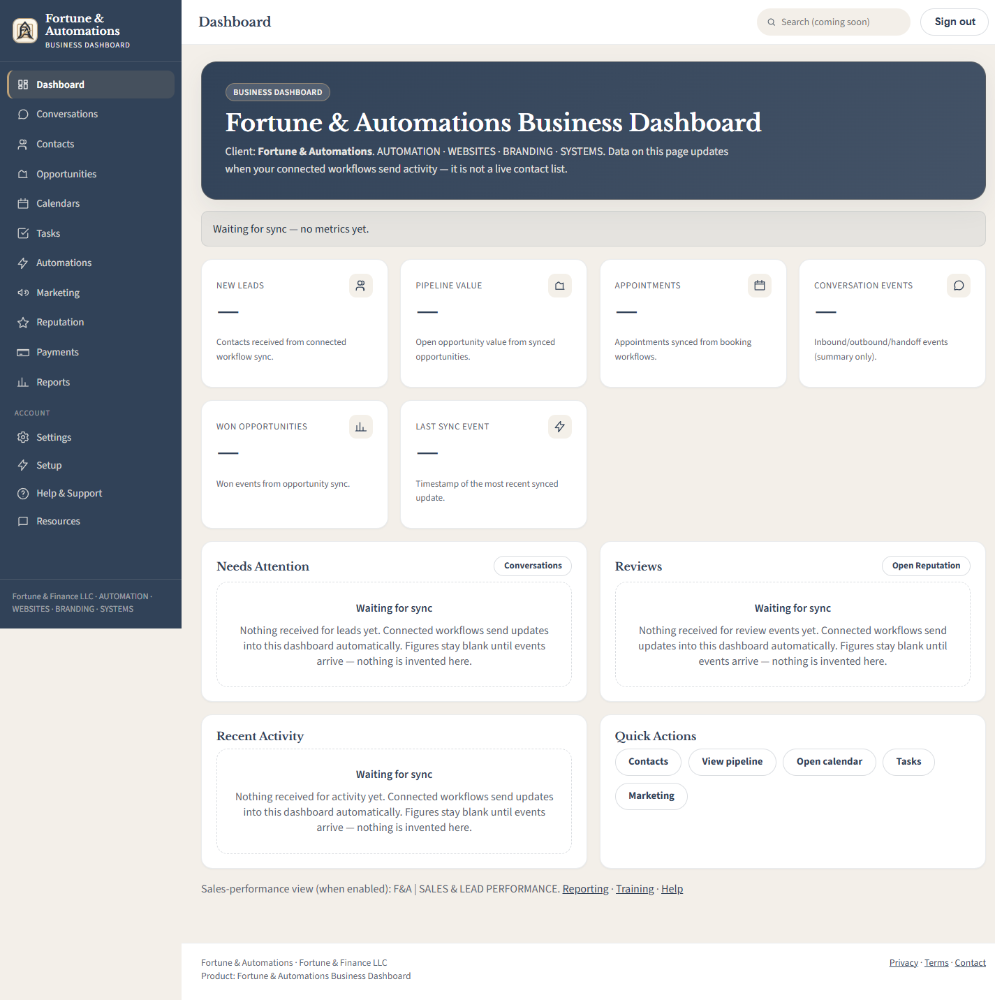
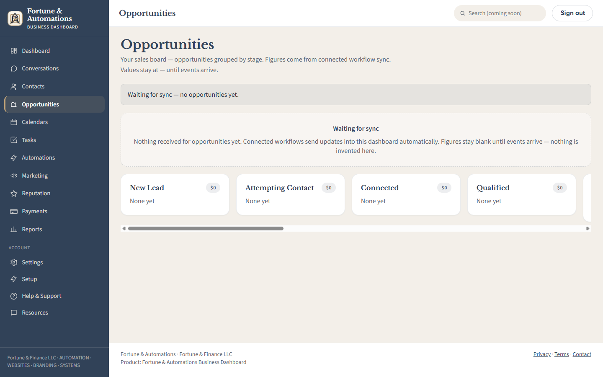

# Fortune & Automations Business Dashboard

Next.js business dashboard. Native mode (`AUTH_PROVIDER=supabase`) serves many workspaces from one
deployment on Supabase Auth and Postgres with row-level security: contacts, opportunities, calendars,
tasks, internal notes, team and settings per workspace, plus a platform console for provisioning and
support. The design and navigation are unchanged from the original F&A dashboard.

Legacy mode (`AUTH_PROVIDER=legacy`, still the default until the approved cutover) keeps the original
cookie login and shows the F&A data as a read-only snapshot of the last workflow-synced activity.
Workflow (HighLevel) sync was retired in P7; history is in `docs/archive/`.

Design and phase record: `docs/NATIVE_MULTI_TENANT_SPEC.md` and `docs/NATIVE_MULTI_TENANT_CHECKLIST.md`.

## Screenshots

These checked-in examples show the original design baseline with empty data, not the current native
CRM or a live customer account. Legacy workflow-sync labels in these images are historical;
native mode uses workspace-owned records directly.





[Browse all 20 design baseline screenshots](docs/baseline/screenshots).

## Features and release status

- Workspace-scoped contacts, pipeline, calendars, appointments, tasks and internal notes.
- Team roles, permission overrides, invitations and workspace settings.
- Platform administration with MFA, provisioning, suspension and time-limited support grants.
- Supabase Auth, PostgreSQL row-level security, audited operations and private Storage.

Implementation and staging validation are recorded in [the release handoff](docs/RELEASE_HANDOFF.md).
The recovery follow-up passed 287 unit tests, 250 PGlite tests, 10 disposable local Supabase recovery
tests and 6 hosted staging MFA checks, plus strict TypeScript and a production build. These are
recorded results, not a claim that all possible security problems have been eliminated.
Production cutover remains separate: see [the production release plan](docs/PRODUCTION_RELEASE_PLAN.md).

## Stack

Next.js 15, React 18, TypeScript, Supabase Auth/Postgres/Storage, Zod and Playwright-based browser tests.
Use Node.js 24; Docker Desktop must be running for disposable Supabase integration tests.

## Local

```bash
cp .env.example .env.local
npm ci
npm test
npm run dev
```

Open http://localhost:3000 → redirects to `/login`.

On PowerShell, replace the first command with `Copy-Item .env.example .env.local`.
Configure local development credentials privately before starting the app. The example file contains
configuration names and placeholders, not working credentials. Do not point test runners at production.

## Environment

Names only — values are owner secrets and are never committed or printed. See `.env.example`.

- `AUTH_PROVIDER` — `legacy` (default) or `supabase`
- Native mode (all server-side): `SUPABASE_URL`, `SUPABASE_PUBLISHABLE_KEY` (or `SUPABASE_ANON_KEY`), `SUPABASE_SERVICE_ROLE_KEY`, `APP_ORIGIN`
- Legacy mode: `AUTH_SECRET`, `AUTH_OWNER_EMAIL` / `AUTH_OWNER_PASSWORD` (optional admin/client logins),
  optional `SUPABASE_URL` + `SUPABASE_SERVICE_ROLE_KEY` for the session store and the read-only snapshot

## Safety

- Production (`VERCEL_ENV=production`) fails closed when legacy auth is not configured
- Workspace isolation is enforced in Postgres (RLS); the service-role key is confined to an allowlisted server module
- No outbound email/SMS, no external CRM calls
- `.env*` files are ignored except the tracked `.env.example` template. Real credentials, database
  exports, local build output and dependencies do not belong in Git. Ignoring a file does not remove
  a secret previously committed to history; rotate an exposed credential rather than relying on hiding it.

## Repository guide

| Location | Contents |
|---|---|
| `src/` | Application pages, components, API routes and server logic |
| `supabase/migrations/` | Versioned database migrations |
| `scripts/` | Test runner and operator tools |
| `tests/` | Unit, database, concurrency, integration, staging and acceptance checks |
| `docs/` | Specification, design baselines, test evidence and release procedures |

Pushing or merging to `release` deploys production automatically. Keep development work on a feature
branch until the release plan's approvals and backup gates are satisfied.

## Scripts

| Command | Purpose |
|---------|---------|
| `npm test` | All suites via `scripts/run-tests.mjs` (fails closed; Docker-backed suites report BLOCKED when Docker is missing) |
| `npm run test:unit` / `test:db` / `test:db:concurrency` / `test:stack` | One suite |
| `npm run typecheck` | Strict TypeScript for app and tests |
| `npm run build` | Production build |
| `npm run verify:auth` | Probe a running deployment's auth behavior |
